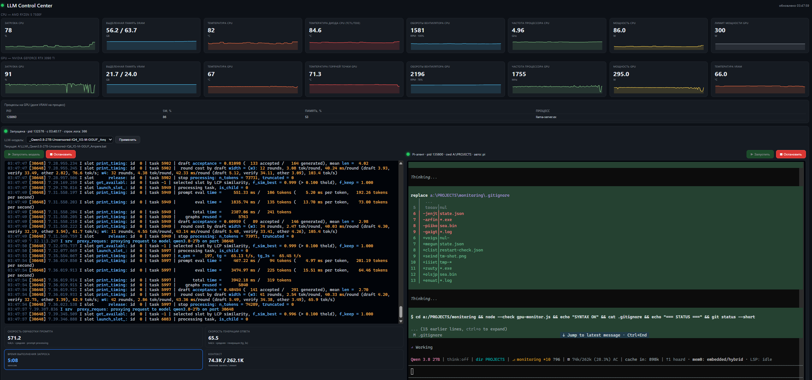

# LLM Control Center (RTX 3090 Ti)


Онлайн-мониторинг CPU и GPU. Дашборд переименован из «GPU Monitor» в **LLM Control Center**
(заголовок страницы, заголовок окна, иконка в треи). Вверху страницы — две линии карточек,
под каждым значением — спарклайн (последние 2 минуты):

- **линия CPU** (8 карточек): загрузка %, DRAM (выделено/всего GB), температура
  (Tdie — самое горячее ядро, как «ЦП» у AIDA64), температура диода (Tctl/Tdie — «ЦП диод»),
  вентилятор CPU (RPM + % управления), частота процессора (ГГц — «Скорость» как в диспетчере
  задач Windows 11), мощность (W), лимит мощности GPU (W).
- **линия GPU** (8 карточек): загрузка %, VRAM (GB), температура, горячая точка GPU,
  вентилятор (RPM + доля NVML %), частота ядра (MHz), мощность (W), температура VRAM (°C).

Данные CPU/материнской платы/DRAM берутся из **LibreHardwareMonitor** (LHM) — те же физические
датчики, что у Armoury Crate (SMU: Tdie/Tctl, BCLK, P-state; NCT6799D: вентиляторы, VRM, плата,
+12V/+5V; DIMM SPD: температура DRAM); данные GPU — из `nvidia-smi` (включая `temperature.memory`
и `clocks.mem`). Все сенсорные значения (BCLK, температуры DRAM/платы/VRM, напряжения +12V/+5V/Vcore,
частота памяти GPU) доступны в JSON `GET /api/stats` и в логе консольного режима.
Отдельная панель LLM: выбор батника (список каталога + произвольный путь, запоминается в `state.json`),
запуск/остановка модели, живой лог вывода, метрики: **скорость обработки промпта** и **скорость генерации**
(tok/s, средние по окну ~60 с) и **время выполнения запроса** (секундомер от отправки промпта до полного
idle `pi`), автозапуск модели при открытии дашборда.
Окно PowerShell (правые 60% экрана, автозапуск `pi` из `A:\PROJECTS`) —
открывается автоматически при загрузке страницы, а также по кнопке «⊞ PowerShell».
Встроенный интерактивный **PowerShell** прямо в браузере (xterm.js + node-pty/ConPTY):
реальная консоль, которая сама запускает `pi` из `A:\PROJECTS`, — в панели LLM справа от лога.
Один файл; нужен **Node.js 18+**, **nvidia-smi** (идёт с драйвером NVIDIA) и **node-pty**
(в `node_modules`, ставится `npm install` — только для встроенного терминала, не для `--console`).
## Запуск

```bash
# веб-дашборд (по умолчанию http://192.168.1.117:8787)
node gpu-monitor.js

# вывод в терминал
node gpu-monitor.js --console
```

Через npm: `npm start` (веб) или `npm run console`.


## gpu-monitor.exe

Готовый exe: запускает веб-сервер и сам открывает дашборд в браузере.

```bash
gpu-monitor.exe               # сервер + автооткрытие http://192.168.1.117:8787 в браузере
gpu-monitor.exe --console     # режим терминала (без браузера)
gpu-monitor.exe --port 9000   # свой порт (браузер откроет http://192.168.1.117:9000)
```

Сборка exe: `node build-exe.js` (нужен Node 18.19+ в PATH — скрипт генерирует SEA-бандл,
копирует `node.exe` и вшивает бандл через `postject`). Exe лежит рядом с проектом и
использует его `node_modules` (node-pty) и `nvidia-smi` из PATH. Закройте окно консоли exe,
чтобы остановить сервер.
Пока монитор запущен, собирать лучше `node build-new.js` — он даёт `gpu-monitor.new.exe`
(не трогает работающий exe); подмена новой сборки — `restart-monitor.ps1` / `restart-cputime.ps1`
(убивает старый процесс → переименовывает → стартует → запускает LLM-модель).
## Опции

| Флаг | По умолчанию | Описание |
|------|--------------|----------|
| `--port <n>` | `8787` | Порт веб-дашборда |
| `--host <ip>` | `192.168.1.117` | Адрес, на котором веб-сервер принимает подключения (для доступа с других машин) |
| `--gpu <idx>` | авто (3090 Ti) | Выбрать GPU по индексу (`nvidia-smi -L`) |
| `--interval <ms>` | `1000` | Период опроса |
| `--bat <path>` | `A:\LLM\_Qwen3.8-27B-Uncensored-IQ4_XS-M-GGUF_Ampere.bat` | Батник LLM для запуска/остановки |
| `--bats-dir <path>` | каталог батника по умолчанию | Каталог, из которого UI предлагает список `.bat`-файлов |
| `--console` | — | Режим терминала вместо веб-сервера (без LLM-панели) |
| `--term-cwd <path>` | `A:\PROJECTS` | Каталог, в котором работает встроенный PowerShell (он сам запускает `pi`) |

## LLM-батник `_Qwen3.8-27B-Uncensored-IQ4_XS-M-GGUF_Ampere.bat`

В репозитории лежит эталонный батник, которым поднимается LLM-сервер для панели LLM.
Бэкенд — **llamAmpere** (форк llama.cpp от JakeATX, заточенный под RTX 3090 / 3090 Ti —
Ampere, SM86), Windows-сборка `A:\LLM\llamAmpere\build-win64-cuda\bin\llama-server.exe`.
Запускается через `LlmManager` (кнопка «▶» / автозапуск при открытии дашборда).

Батник работает в **router-режиме**: один `llama-server` обслуживает несколько моделей
по пресету `A:\LLM\llamAmpere\router-models\pi-models.ini` (копия — `llamAmpere/router-models/pi-models.ini`
в репозитории). При старте грузятся основные модели, остальные — по требованию
(в pi команда `/llama`, в Continue — роли embed/rerank).

| Модель | Назначение | Контекст | Загрузка |
|---|---|---|---|
| `qwen3.8-27b` | Qwen 3.8 27B Uncensored IQ4_XS-M + зрение (mmproj) | 262K | при старте |
| `qwen2.5-coder-1.5b` | Qwen2.5 Coder 1.5B Q4_K_M (Tab-автодополнение) | 8K | по требованию (в пресете закомментирована) |
| `qwen3-embedding-0.6b` | Qwen3 Embedding 0.6B (роль embed в Continue) | 4K | по требованию |
| `qwen3-reranker-0.6b` | Qwen3 Reranker 0.6B (роль rerank в Continue) | 4K | по требованию |

Ниже — что делает каждая команда и каждый флаг.

### llamAmpere v0.5 (информация от разработчика)

- **llamAmpere** — форк llama.cpp, оптимизированный под RTX 3090 / 3090 Ti (Ampere, SM86):
  Qwen3.8-27B работает со своей **MTP draft-головой** — спекулятивный драфт
  **включён по умолчанию** для Qwen3.8 GGUF с MTP-головой (никаких `--spec-*` флагов не нужно).
- **SJ-KVaRN** — новый сжатый KV-кэш (конфигурации 4/4, 3/3t, 3/2t) на методе KVarN:
  при 4/4 на 41% ниже KL, чем у tq5_0/turbo4 из v0.4, при 2% больше памяти кэша;
  полный контекст 262K (262,144 токенов) **помещается на одной 24GB-карте** (пик 21,924 MiB).
- **Prompt-кэш включён по умолчанию** — RAM-ярус по размеру памяти хоста + дисковый ярус
  (до 16 GiB, в батнике расширен до 24 GiB) для любых типов KV. Возобновлённый разговор
  не делает полный re-prefill. `--no-cache-disk` отключает дисковый ярус.
- **Быстрый декод на 100K**: v0.5 с tq5_0/turbo4 — +8.41% к v0.4 на глубине 100K.
- **Патчи v0.5.x**: SJ-KVaRN работает с `--parallel N` (v0.5.1); фиксы префилла и SJ-KVaRN,
  RAM-кэш держит 4 последних чекпоинта, `--sjkvarn-transform` (v0.5.2); разговор,
  возобновлённый из prompt-кэша, отвечает как при свежем чтении, дисковый кэш работает
  с `--mmproj` (v0.5.3); фикс краша `--parallel 3+` с MTP-драфтером (v0.5.4);
  `--eval-cache DIR` — только-чтение prompt-кэш для бенчмарков (v0.5.5).
- Сервер **OpenAI-совместимый** (по умолчанию `http://127.0.0.1:8080`; здесь `--host`/`--port`
  переопределены под LAN).
- Документация разработчика: [JakeATX/llamAmpere](https://github.com/JakeATX/llamAmpere) —
  release notes v0.5 и `docs/llamampere-v0.5/RECOMMENDED.md` (рекомендованные конфигурации
  под каждый размер карты; батник использует вариант «Pure speed»: `tq5_0/turbo4`).

### Подготовка окружения (до запуска сервера)

| Команда | Ответственность |
|------|-----------------|
| `nvidia-smi -i 1 -pl 300` | Ограничивает **пиковое** потребление RTX 3090 Ti до сбалансированных **300 Вт** (убирает треск от резких пиков). Глобальный индекс шины `1`, подтверждён `nvidia-smi`. Идёт первым — до остальных операций. |
| `nvidia-smi -i 1 -rgc` | **Сбрасывает фиксацию частоты ядра** (reset GPU clocks) — драйвер сам подбирает частоту (boost). LLM-генерация упирается в пропускную способность VRAM, а не в частоту ядра, поэтому `-lgc` почти не даёт скорости, зато держит лишний нагрев в простое. |
| `chcp 65001 > nul` | Устанавливает кодировку консоли в **UTF-8** (повторно после nvidia-smi, который её сбрасывает). |
| `cls` | Очистка экрана. |
| `title llamAmpere Router: …` | Заголовок окна: режим роутера и список моделей. |
| `taskkill /f /im freetoken.exe /im ft.exe /im python.exe /im llama-server.exe /im llama-cli.exe` | Полная очистка от **зависших** ИИ-процессов (включая `llama-cli.exe`), чтобы не было дублей и не занятой VRAM. |
| `set CUDA_VISIBLE_DEVICES=0` | **Изоляция**: для llama-server видна только карта с локальным индексом `0` (RTX 3090 Ti), вторая карта (RTX 4060) от неё скрыта — вся работа уходит на 3090 Ti. CUDA-индекс `0` = физический GPU `1` в `nvidia-smi` (порядок определяет драйвер). |
| `set GGML_CUDA_FA_I8QK=1` | **Ускорение префилла**: int8 Q*K-внимание в flash-attn (опция llamAmpere v0.5, по умолчанию выключена). |

### Флаги llama-server

| Флаг | Значение | Ответственность |
|------|----------|-----------------|
| `--models-preset "A:\LLM\llamAmpere\router-models\pi-models.ini"` | путь | **Пресет роутера**: INI-файл с секциями моделей (`[qwen3.8-27b]`, `[qwen2.5-coder-1.5b]`, `[qwen3-embedding-0.6b]`, `[qwen3-reranker-0.6b]`). В каждой секции — `model` (путь к GGUF), `mmproj` (зрение), `ctx-size`, `ngl`, `flash-attn`, `cache-type-k/v` (tq5_0/turbo4 — «Pure speed»), `batch-size`/`ubatch-size`, `parallel`, `image-min-tokens`, `no-reasoning-preserve`, `load-on-startup`. |
| `--no-models-autoload` | — | Не поднимать ВСЕ модели пресета автоматически: грузятся только секции с `load-on-startup = true` (сейчас — `qwen3.8-27b`), остальные — по требованию (`/llama` в pi, роли embed/rerank в Continue). |
| `--host 192.168.1.117` | IP | Адрес, на котором слушает сервер (доступ с других машин). |
| `--port 9931` | порт | Порт API (OpenAI-совместимый). |
| `--cors-origins "*"` | * | Разрешить **CORS** со всех источников (доступ из браузера/локальных UI). |
| `--api-key "local-bypass"` | — | **API-ключ** для запросов (любой ненулевой ключ; `local-bypass` — локальный bypass). |
| `--cache-disk-path "A:\LLM\prompt-cache"` | путь | **Дисковый prompt-кэш** (llamAmpere v0.5, включён по умолчанию) — общий для всех моделей роутера. |
| `--cache-disk-limit 24576` | 24576 | Лимит дискового prompt-кэша — 24 GiB (24576 MiB). |

> Примечание: MTP-драфтер и prompt-кэш **включены по умолчанию** в llamAmpere
> (для Qwen3.8 GGUF с MTP-головой) — флаги `--spec-*` в батнике не нужны.
> Контекст 262K (262144) для 27B задаётся в пресете (`ctx-size`): полный 262K
> помещается на одной 24GB-карте (при SJ-KVaRN 4/4 — пик 21,924 MiB); при 300W
> скорость декода ~50–60 т/с. KV: tq5_0/turbo4 — максимальная скорость декода;
> альтернатива — sjkvarn4/sjkvarn4 (SJ-KVaRN 4/4, «Balanced»).
> `^` в конце строк — продолжение одной команды в `cmd.exe`.
> Тело `.bat` — на русском, но **только 2-байтовая кириллица (UTF-8)**: без
> трёхбайтовых символов (кавычки-ёлочки «», длинное тире —, многоточие …) —
> под `chcp 65001` `cmd.exe` на них десинхронизируется и исполняет хвост
> кириллической строки как команду (в логе было `'ива:' is not recognized...` —
> хвост комментария "Альтернатива:").
## Как устроено

- Раз в секунду выполняется `nvidia-smi --query-gpu=... --format=csv` (без админ-прав), включая
  `temperature.memory` (температура VRAM) и `clocks.mem` (частота памяти GPU).
- 3090 Ti выбирается автоматически по имени; если таких нет — берётся первый GPU.
- Держится история ~5 минут (300 сэмплов); дашборд рисует графики последних 2 минут.
- API: `GET /api/stats` → JSON `{ latest, history, error, gpus }`; в `latest` — все сенсорные поля:
  CPU Tdie/Tctl, мощность, частота (PDH/WMI/P-state), BCLK, вентиляторы RPM+%, температуры VRAM/DRAM,
  VRM/материнская плата, +12V/+5V/Vcore, частота памяти GPU.
- LLM: `LlmManager` запускает батник через `cmd.exe /c` (скрытое окно, `stdin` игнорируется,
  чтобы финальный `pause` не висел), ловит stdout/stderr в кольцевой буфер (5000 строк).
  Остановка — `taskkill /f /t /pid` (весь процессный поддерево).
- LLM API: `GET /api/llm`, `GET /api/log?after=<id>`, `POST /api/llm/start`, `POST /api/llm/stop`.
- Метрики LLM: `LlmManager` парсит лог llama-server — «prompt processing … tokens per second» (скорость обработки промпта, среднее по строкам;
  для старых сборок — «prompt eval time»)
  и «n_gen» (скорость генерации), средние по окну ~60 с; последние вычисленные значения кэшируются
  и не очищаются после завершения запроса (сброс — только перезапуск модели).
- Время выполнения запроса: `RequestTimer` меряет от отправки промпта до полного idle `pi`.
  Старт — строка лога llama-server (`HTTP request: POST …` или `processing task, is_child`),
  финиш — когда `pi` перестал работать: `PtyTerm` детектит брайлевый спиннер (⠋⠙⠹…) в выводе `pi`
  (кадры обновляются ~80 мс; отсутствие кадров > 400 мс — `pi` idle), цикл завершается после
  подтверждения idle 1,5 с (защита от мерцания спиннера и провалов кадров pty). Один ход `pi`
  — это несколько вызовов LLM и инструментов, поэтому промежуточные строки «total time»
  секундомер не перезапускают. UI показывает живое значение (тик 100 мс) во время запроса,
  после завершения — замороженный итог.
- Автозапуск LLM: при загрузке дашборда, если модель не запущена, стартует батник из `state.json`
  (симметрично автозапуску встроенного терминала).
- Остановка: каждый синхронный шаг cleanup (taskkill и т.п.) ограничен своим таймаутом, плюс страховка
  на 30 с — принудительный выход, если cleanup завис. `killGpuMonitors()` убивает ВСЕ процессы
  `gpu-monitor.exe` (текущий и дубли); в меню трей-иконки перед `taskkill llama-server` стоит
  `taskkill /F /IM gpu-monitor.exe` — гарантированное завершение даже если POST /api/shutdown не дошёл.
- `restart-monitor.ps1` — одноразовый перезапуск `gpu-monitor.exe` после правок `gpu-monitor.js`
  (ждёт, убивает старый процесс, стартует новый, убирает переименованный старый exe).
- Выбор батника: `GET /api/bats` — список `.bat`/`.cmd` из каталога; `POST /api/llm/bat {path}` — сменить батник
  (сохраняется в `state.json` и переживает перезапуск монитора; по умолчанию — последний использованный).
- Окно PowerShell: `POST /api/terminal/open` открывает видимое окно — автоматически при загрузке страницы, если оно
  ещё не открыто (сервер проверяет живой процесс `side-powershell.ps1` через `GET /api/terminal` —
  дублирующего окна не будет, а закрытое окно снова поднимется при следующем заходе), и по кнопке «⊞ PowerShell».
  Окно поднимается отдельным окном **Windows Terminal** через `wt.exe -d A:\PROJECTS powershell.exe ...`
  (чтобы боковая консоль не терялась во вкладке уже открытого WT-окна; без `wt.exe` — запасной `cmd /c start`).
  Генерируемым скриптом `side-powershell.ps1` окно в conhost само перемещается в правые 60% экрана
  (`MoveWindow`, user32; в WT позиция задаётся самим Windows Terminal), скрипт добавляет npm-каталог в PATH,
  ставит шрифт **Cascadia Mono 12** (в conhost — через `$Host.UI.RawUI.Font`, в Windows Terminal — из настроек
  профиля «Windows PowerShell»: `colorScheme: Campbell`, `fontFace: Cascadia Mono`, `fontSize: 12`), пишет
  диагностический лог в `log/side-window.log` (PATH, найден ли `pi`) и автоматически запускает `pi` из `A:\PROJECTS`
  (заголовок окна ставится скриптом через `$Host.UI.RawUI.WindowTitle` — параметр `-Title` у powershell.exe ломает парсинг `-File`).
- Встроенный PowerShell: `PtyTerm` поднимает `powershell.exe` через **node-pty** (реальная консоль ConPTY,
  а не pipe-stdio) с аргументами `-NoProfile -NoLogo -NoExit -Command <guard pi>`: PATH PTY дополняется
  npm-каталогом `%USERPROFILE%\AppData\Roaming\npm`, а `pi` запускается через `Get-Command`-проверку
  (если `pi` нет в PATH — жёлтое сообщение с командой установки, консоль не умирает). PowerShell запускает `pi`
  из `--term-cwd` (по умолчанию `A:\PROJECTS`); когда `pi` завершится, остаётся интерактивный промпт.
  Встроенный терминал стартует автоматически при загрузке страницы, если ещё не запущен (иначе — кнопка «▶» в его панели).
  Внешний вид встроенного терминала — схема Windows 11 Terminal **Campbell** (тема xterm.js) + **Cascadia Mono 14**.
  Отрисовка в браузере — **xterm.js** (файлы `web/xterm.js`, `web/xterm.css`, `web/addon-fit.js`, `web/logre.js` раздаются
  с сервера по `/xterm/...`). Вывод — SSE-поток `GET /api/term/out` (base64-чанки, новичку досылаются
  последние ~512 КБ истории), ввод — `POST /api/term/in {text}`, размер — `POST /api/term/resize {cols,rows}`,
  состояние — `GET /api/term`, запуск — `POST /api/term/start {cols,rows}`, остановка — `POST /api/term/stop`.
  WebSocket не нужен: один SSE-канал на вкладку + POST для ввода.
  «⤢ Вся ширина» растягивает дашборд на весь монитор (настройка в localStorage браузера).
  В панели LLM лог ограничен `max-width: 640px`, справа от него — встроенный терминал.
- Датчики CPU/материнской платы/DRAM: скрытый PowerShell-процесс (временный скрипт) гоняет библиотеку
  **LibreHardwareMonitor** (`C:\Program Files\LibreHardwareMonitor\LibreHardwareMonitorLib.dll`; LHM
  устанавливается на машине один раз) и шлёт JSON в stdout: CPU — загрузка, Tdie (самое горячее ядро)
  и Tctl/Tdie (диод), мощность пакета, частота, BCLK, P-state (MSR 0xC0010293, по ядрам через
  thread-affinity), WMI `CurrentClockSpeed`, PDH «Фактическая частота» (`typeperf` — «Скорость» как в
  диспетчере задач Windows 11); материнская плата (NCT6799D, включая SubHardware) — вентиляторы RPM +
  % управления (Control-сенсор), температуры VRM/платы, +12V/+5V/Vcore; память (DIMM SPD) — температура
  DRAM. Те же физические источники, что у Armoury Crate (SMU/EC) — значения совпадают (заметка от 01.11.2026).
- Частота CPU в UI (ГГц): PDH «Фактическая частота» → WMI `CurrentClockSpeed` → P-state (MSR) →
  средняя частота LHM (в этом порядке); в консольном режиме показывается в МГц.
- Консольный режим (`--console`): строка лога содержит помимо GPU-метрик `CPU freq <МГц>`, `CPU <W>`,
  `BCLK <МГц>`, `DRAM <°C>`, `MB <°C>`, `VRM <°C>`.
- Вентиляторы: RPM берётся из LibreHardwareMonitor (CPU — с материнской платы NCT6799D, GPU — с самой
  карты); рядом с значением UI показывает сверку — для GPU долю % от NVML («RPM · 76%»), для CPU —
  % управления (Control-сенсор LHM). Если LHM не отдаёт RPM, UI показывает % от NVML.
- Лог LLM: при загрузке страницы и после запуска автоматически прокручивается к последней строке;
  при прокрутке вверх (чтение истории) авто-скролл отключается, кнопка «⬇ К концу» включает его снова;
  строки ошибок подсвечиваются светло-голубым; весь лог имеет подсветку синтаксиса (timestamp, ключи,
  числа с единицами, URL, Windows-пути, ERROR/WARN/OK/INFO, строки — `web/logre.js`), шрифт — **Consolas 12px**.
